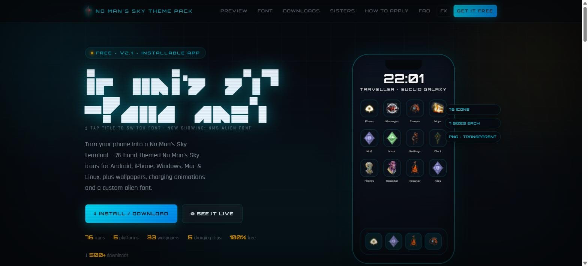
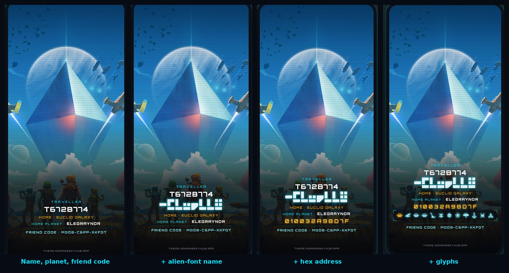
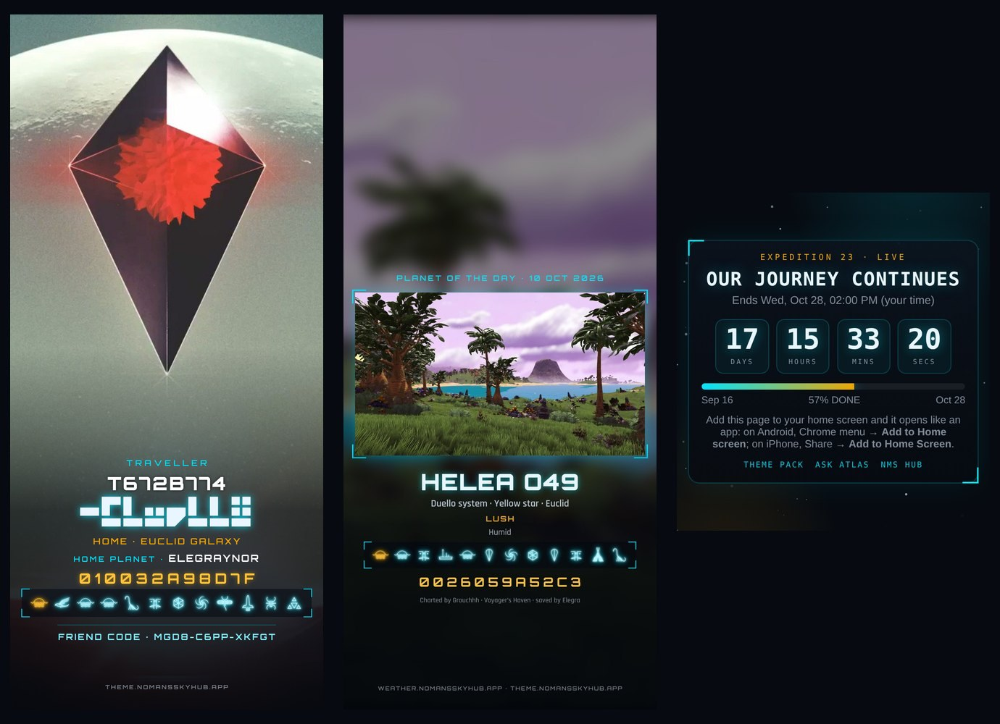
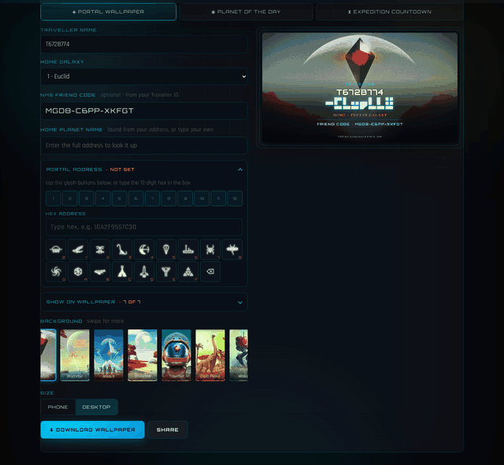
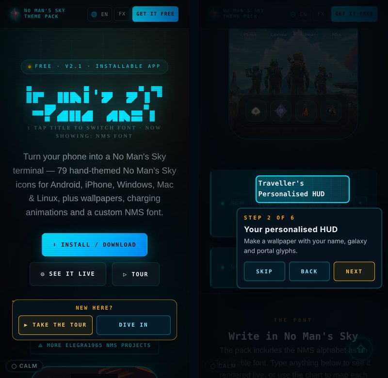
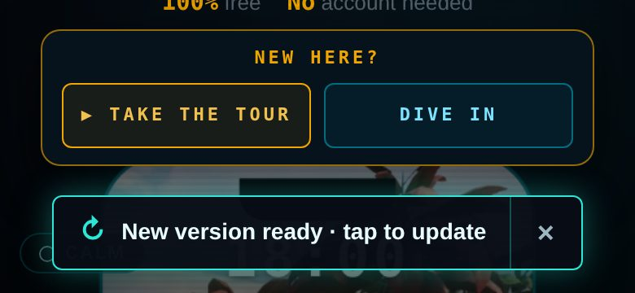
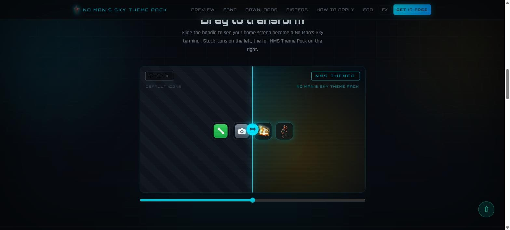
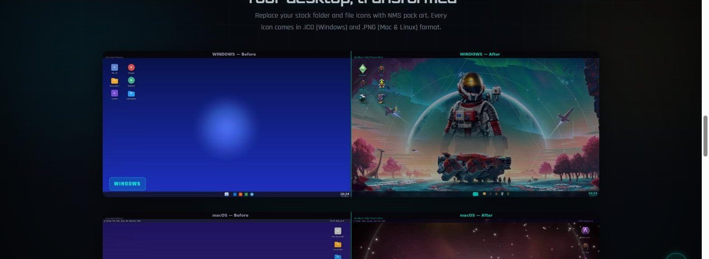
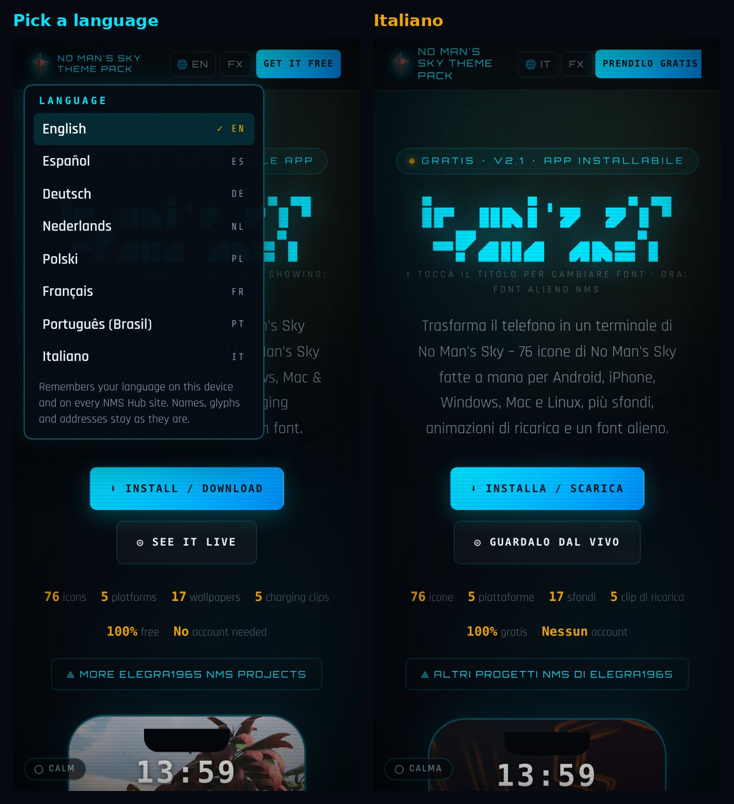

# No Man's Sky Theme Pack

**Live:** [theme.nomansskyhub.app](https://theme.nomansskyhub.app)

Turn your phone or desktop into a *No Man's Sky* terminal. 79 hand-themed icons, 17 wallpapers, 5 charging animations and the NMS alphabet as an installable font. Free, no account, for Android, iPhone, Windows, Mac and Linux.

Part of the [No Man's Sky Hub](https://nomansskyhub.app) family of fan tools.

**Contents** — long sections are folded; tap to open.

- [What's in the pack](#whats-in-the-pack)
- [Make it yours (new)](#make-it-yours-new)
- [New here? Take the tour](#new-here-take-the-tour)
- [The site](#the-site)
- [How it's built](#how-its-built)
- [Credits](#credits)
- [Using this code?](#using-this-code)
- [Licence](#licence)

<!-- folded -->

## What's in the pack

- **79 themed icons**, each exported as transparent PNGs in 6 sizes, plus Windows `.ico` versions
- **17 wallpapers** in 6 resolutions each, for phone and desktop
- **5 charging animations** as watermark-free MP4s for Android and iPhone
- **The NMS alphabet** as an installable TTF font
- **Widget Kit** for KWGT: two NMS-styled frames, both fonts and a step-by-step clock/date widget guide
- **Setup guides** for Android launchers, iPhone, Windows and Mac

## Make it yours (new)

▸ Tap to open

The page now leads with this: the first buttons on the page are **✦ Make it yours** and **▷ Tour**, with Install / Download and See it live underneath. The top menu highlights the section you're reading.

- **Portal wallpaper:** your Traveller name (in English and in the NMS alphabet), home galaxy, home planet name, home portal address (hex and glyphs) and, if you like, your NMS friend code, on one of 15 No Man's Sky backgrounds for phone (1080x2400) or desktop (2560x1440). Switch each line on or off and watch the preview before you download. The name, galaxy and friend code come from your Hub Traveller ID if you've set one. The planet name is looked up from your address in the [Galactic Map](https://map.nomansskyhub.app)'s community edits, then [Voyager's Haven](https://havenmap.online), or you can type your own.
- **Planet of the day:** the Weather Station surveys 8 real, player-charted worlds from [Voyager's Haven](https://havenmap.online) every day. Pick one of today's and download it as a wallpaper, with its portal glyphs, hex and discoverer, plus a link to fly there on the Galactic Map.
- **Your own picture:** **📷 Use your own picture** under the backgrounds puts your name, glyphs and the rest on any photo you pick (a screenshot of your base, your ship…). It's shrunk and kept on your device only; nothing is uploaded.
- **Planet of the day with NMS Almanac:** each of today's 8 worlds now also shows the real planet from [NMS Almanac](https://nmsalmanac.com): its picture (beside the name on phone wallpapers, bottom right on desktop ones, and on each card), the planet's own portal address, weather and sentinels, with the Almanac credited on the wallpaper and under the buttons. Voyager's Haven still picks the worlds.
- **Home planet from NMS Almanac:** on the portal wallpaper, if no traveller has named your home system on the Galactic Map or Voyager's Haven, the home planet name now comes from [NMS Almanac](https://nmsalmanac.com) (shown as “planet name from NMS Almanac”). The **Home portal widget** (widgets page) also uses the Almanac: the planet's type, weather, sentinels and picture, and the system's star, race, economy and conflict, with names a traveller gave still winning, and a “Data: NMS Almanac” link.
- **Expedition countdown:** live time left in the current expedition (or until the next one), with a [home-screen widget page](https://theme.nomansskyhub.app/countdown.html) that installs like an app. Dates come from the No Man's Sky Wiki's List of Expeditions, redux runs included. Under the clock, the widget page also shows the live **Community Research** tier and progress (e.g. *Tier 2 of 2 · 41%*), read from Hello Games' official Galactic Atlas, the same number as its [Community Research](https://galacticatlas.nomanssky.com/poi/community-research) sidebar; tap it to open that page.

**🔔 Tell me about new wallpapers & icons** (under Downloads) turns on a phone notification when something new is added. New things are listed in `updates.json` (`id`, `date`, `en` text); the Weather station's alert server sends the newest one once (`nms-push.js`).

Everything is drawn in your browser; nothing is uploaded. The only thing sent anywhere is your portal address, to look up the planet name.

## New here? Take the tour

First-time visitors get a small **New here? ▶ Take the tour / Dive in** box (shown once, never again). The tour dims the page and spotlights Install / Download, the personalised HUD, widgets, the NMS font, the live preview and How to apply, one step at a time with Back / Next / Skip. Replay it any time from the **▷ TOUR (next to See it live)** button. The phone's Back button closes it, and it's translated into every language the site offers. Shared `nms-tour.js`, the same file on every nomansskyhub.app site.

The last step is **Your language**: it points at the 🌐 button, because one choice there changes every site in the family.

**Back to top.** Once you scroll down, a teal ⇧ arrow appears in the bottom-right corner. Tap it to glide back to the top (instant with reduced motion). It's the same arrow on every No Man's Sky Hub site.

## The site

▸ Tap to open

- An interactive phone mockup and a live grid of every icon
- A live NMS alphabet translator and glyph chart
- A drag-to-compare before/after slider, and before/after desktops for Windows and macOS
- Platform-aware install as an app (Android prompt, iPhone guide)
- **Share buttons.** Reddit, X and Discord. Discord has no share link, so the Discord button copies a short message with the link, says “Copied — paste it in any server or DM”, and opens Discord so you can pick where to post it.
- **Calm mode.** A small **Calm** switch in the bottom-left corner swaps the patterned and image backgrounds for a plain dark one, for anyone who finds the page busy. It's shared across the whole No Man's Sky Hub family (one switch turns it on for every site), in `calm.js`.
- **Your language.** The 🌐 button switches the page between English, Español, Deutsch, Nederlands, Polski, Français, Português (Brasil) and Italiano. The widgets and the countdown page follow it too, with dates in your language. The choice is shared by the whole No Man's Sky Hub family: pick it once and every site follows (a small cookie on `.nomansskyhub.app`; when you pick a language, an anonymous count of which one is sent to the site's cookie-free GoatCounter stats, so we can see which languages people use). On a first visit the page offers your phone's language once instead of switching by itself. Names, glyphs and portal addresses stay as they are. It lives in `lang.js` (the same file on every site), with one small pack per language in `lang/` and a font for Polish letters in `fonts/`.
- **Always the newest version.** An installed app on a phone isn't reloaded when you switch back to it, so it could keep showing an old version until it was closed and reopened. Now, each time you come back to it (and every 30 minutes while it stays open), it checks for a new version. If one is live, a small bar says “New version ready · tap to update”, in your language. One tap reloads in place; × hides it. It never reloads by itself, so nothing you're in the middle of is lost. It lives in `nms-update.js`, the same file on every site.
- **⟳ Refresh.** In the installed app there's no browser reload button (and pull-to-refresh doesn't work everywhere), so a small ⟳ button sits next to the language button. Tap it and it checks for a new version and reloads in place, on the same view. It only shows in the installed app. After a big batch of updates, the first open on that day says “✓ Updated · that's the last update today”, so nobody wonders if more pop-ups are coming. The old nms-theme-pack.netlify.app address now sends search engines here with a permanent (301) redirect.

  

## How it's built

▸ Tap to open

A plain HTML/CSS/JavaScript site with no build step. Deployed on Netlify straight from this repo: every push to `main` goes live.

| Path | What it is |
|---|---|
| `index.html` | The download site |
| `polish.css`, `polish.js` | HUD-style card treatment and line icons (v2.2 polish) |
| `studio.js`, `studio.css`, `assets/studio/` | "Make it yours": portal wallpaper, planet of the day and the countdown card |
| `expedition.js`, `countdown.html`, `countdown.webmanifest` | Expedition dates from the NMS Wiki and the installable countdown widget page |
| `_redirects` | Same-origin proxy `/nms-api/*` to the Galactic Atlas API (Community Research on the countdown page) |
| `preview.html` | Full phone preview |
| `HOW_TO_APPLY_ICONS.html` | Setup guide |
| `android_icon_pack_mapping.xml` | Launcher mapping for icon-pack apps |
| `assets/*.zip` | The downloads: icons, wallpapers, charging animations, widget kit |
| `assets/icons/`, `assets/widgets/` | Icon previews and widget kit files |
| `sw.js`, `manifest.json`, `pwa/` | Install and offline support |
| `lang.js`, `lang/`, `fonts/` | Language picker and translations, shared by every Hub site |

## Credits

- NMS Alphabet font by seontonppa (built with FontStruct), used with permission
- Planet info and planet pictures (Planet of the day, Home portal widget, home planet name): [NMS Almanac](https://nmsalmanac.com) by Borjomi
- Player-charted worlds: [Voyager's Haven](https://havenmap.online)

## Using this code?

It's free to use under the MIT licence. If you use any of it in your own project, site, video or post, please credit **elegra1965 / No Man's Sky Hub** with a link to [nomansskyhub.app](https://nomansskyhub.app). The MIT licence also asks you to keep the copyright notice in `LICENSE` with any copied code.

## Licence

The code is MIT licensed (see `LICENSE`). Game names, icons and imagery belong to Hello Games and are not covered by that licence.

*An unofficial, fan-made project. Not affiliated with, sponsored by, or endorsed by Hello Games.*

Built by elegra1965.
